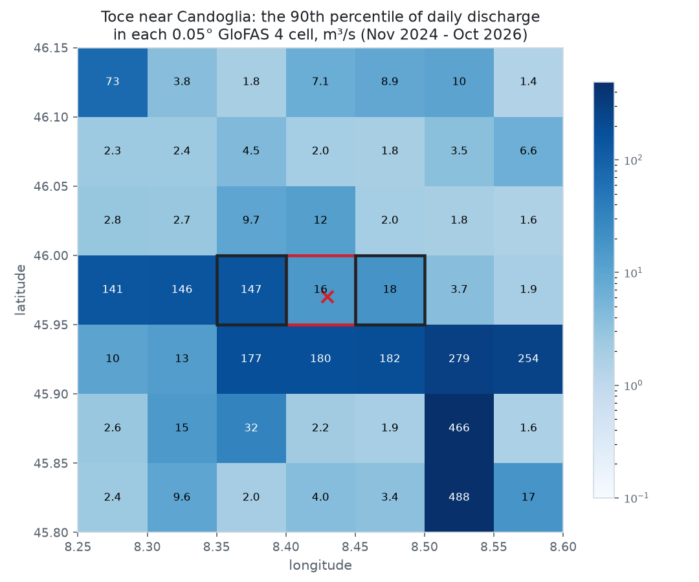
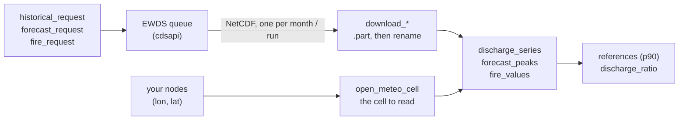
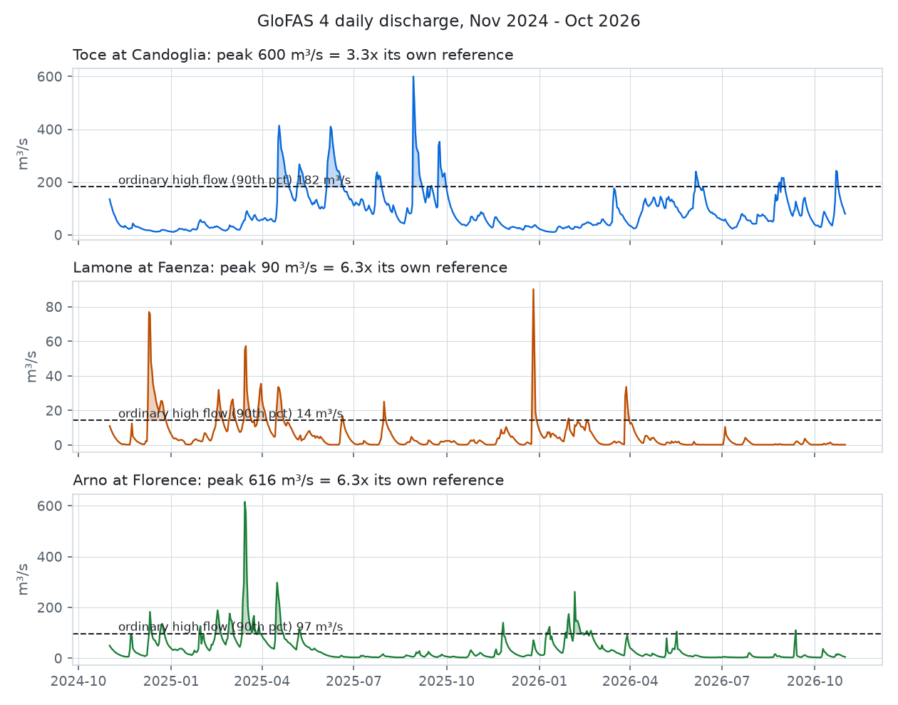

# glofas-ewds

**Is this river high for *this* river?** GloFAS river discharge and the
Copernicus Fire Weather Index from the Early Warning Data Store, read on the
right grid cell.

[](https://github.com/agent-engineering-studio/glofas-ewds/actions/workflows/ci.yml)
[](https://pypi.org/project/glofas-ewds/)
[](https://agentengineering.it/glofas-ewds/)


[](https://github.com/agent-engineering-studio/glofas-ewds/blob/main/LICENSE)

```python
open_meteo_cell(8.43, 45.97)  # (8.475, 45.975): the cell whose numbers you are really reading
discharge_ratio(600.2, 181.9)  # 3.3: the Toce's peak against its own ordinary high flow
```

<picture>
  <source media="(prefers-color-scheme: dark)" srcset="https://raw.githubusercontent.com/agent-engineering-studio/glofas-ewds/main/docs/images/cells-dark.png">
  
</picture>
<sub>One river, 49 cells. The 90th percentile of daily GloFAS 4 discharge in each
0.05° cell around the Toce near Candoglia, Nov 2024 to Oct 2026, from the public
Open-Meteo flood API, on Open-Meteo's own coordinates. The red cell is the one
under the point (16 m³/s); one cell west, 147 m³/s. Drawn by
<a href="https://github.com/agent-engineering-studio/glofas-ewds/blob/main/docs/make_images.py"><code>docs/make_images.py</code></a>.</sub>

- [What is it, in 30 seconds](#what-is-it-in-30-seconds)
- [Who is it for](#who-is-it-for)
- [Quick start](#quick-start)
- [How it works](#how-it-works)
- [Recipes](#recipes)
- [The traps we already fell into](#the-traps-we-already-fell-into)
- [API at a glance](#api-at-a-glance)
- [Data licence and credits](#data-licence-and-credits)

## What is it, in 30 seconds

[GloFAS](https://global-flood.emergency.copernicus.eu/), the Global Flood
Awareness System of Copernicus, models the discharge of every river on Earth
on a 0.05° grid (about 5 km), every day, with a forecast for the days ahead.
The [Early Warning Data Store](https://ewds.climate.copernicus.eu/) (EWDS)
serves it as NetCDF grids, together with the Fire Weather Index Copernicus
computes on ERA5.

The data is free. Using it well is not: a cell too far west turns a river into
a creek, a model version too new halves every number, and a recent month asked
for the wrong way does not exist. This package holds the requests and the
readers that get those right.

| | What you get |
|---|---|
| 🎯 | **The right cell** for a point: `open_meteo_cell`, the same cell Open-Meteo serves, so a reference from the EWDS and a forecast from Open-Meteo describe the same water |
| 📜 | **The requests, built for you**: GloFAS 4 history (consolidated, then intermediate), the 00 UTC control forecast, the six FWI components; split by month |
| 📦 | **Downloads you can re-run**: one file per month or run, nothing asked twice, never half a file left behind |
| 📈 | **Numbers per node**: daily series, forecast peaks, FWI components, for your own list of points |
| 📏 | **A reference per river**: `references` and `discharge_ratio`, the forecast peak against the node's own ordinary high flow |
| 🧪 | **Pure where it can be**: `import glofas_ewds` needs only numpy; `cdsapi` and `netCDF4` are extras |

## Who is it for

- Anyone who turns GloFAS into **alerts or scores**: a flood model, a
  dashboard, a newsroom map. A ratio to the river's own high flow is
  comparable between the Po and a torrent; a raw m³/s is not.
- People who already read the **Open-Meteo flood API** and want the history
  in bulk from Copernicus instead of node by node, without the two disagreeing.
- Fire-weather people checking **their own FWI** against the Copernicus one.

It was extracted from [Limen](https://github.com/agent-engineering-studio/limen),
the landslide, flood and wildfire monitor for Italy, where it fills the
reference of 3,366 river nodes from about 25 monthly requests instead of about
52 calls per node to a public API capped at 10,000 calls a day. On 36,637
points (the whole 0.1° lattice of Italy plus 20,000 random ones) it picks the
same cell as Limen's own code, and every request and reader gives identical
results.

## Quick start

```bash
pip install "glofas-ewds[ewds,netcdf]"
```

You need an [EWDS account](https://ewds.climate.copernicus.eu/) and its API
key, in `CDSAPI_URL` / `CDSAPI_KEY` or `~/.cdsapirc`, and you must accept the
licence of each dataset once on its page.

```python
import asyncio
from datetime import date

from glofas_ewds import (
    EwdsClient,
    discharge_ratio,
    discharge_series,
    forecast_peaks,
    references,
)

NODES = [(8.43, 45.97), (11.88, 44.29), (11.25, 43.77)]  # Toce, Lamone, Arno


async def main() -> None:
    ewds = EwdsClient("data/ewds")
    start, end = date(2024, 11, 1), date(2026, 10, 31)

    history = await ewds.history(start, end)  # 24 monthly files
    ref = references(discharge_series(history, NODES, start=start, end=end), p=0.9)

    latest = await ewds.latest_forecast()  # today's run, or yesterday's
    if latest is not None:
        run, path = latest
        for node, peak in forecast_peaks(path, NODES).items():
            print(run, node, round(peak), discharge_ratio(peak, ref[node]))


asyncio.run(main())
```

Each EWDS request waits in a queue, often for minutes; `EwdsClient` waits in a
thread, so your event loop keeps serving. No live output is shown here: this
release was built without an EWDS key, and the readers were checked against
synthetic files and against Limen's code.

## How it works



<picture>
  <source media="(prefers-color-scheme: dark)" srcset="https://raw.githubusercontent.com/agent-engineering-studio/glofas-ewds/main/docs/images/series-dark.png">
  
</picture>
<sub>Three rivers, three scales. The dashed line is each river's own 90th
percentile: the Lamone's 90 m³/s is 6.3 times its ordinary high flow, the
Toce's 600 only 3.3. Real GloFAS 4 data via Open-Meteo, on the cell of the nine
around each town with the largest mean flow.</sub>

## Recipes

**A reference without an account.** The pure parts work on any series:

```python
from glofas_ewds import references

references({"toce": series}, p=0.9, min_days=365)  # None below a year of days
```

**Your own retry, budget or timeout.** Every download takes any object with
`retrieve(dataset, request, target)`:

```python
from glofas_ewds import cdsapi_client, download_history

download_history(folder, start, end, client=MyQueueWithTimeout(cdsapi_client()))
```

**Another area.** Every request and download takes `area=(north, west, south,
east)`; files for an area other than Italy carry the area in their name, so
two areas can share a folder.

**The official FWI next to yours.**

```python
files = await ewds.fire(date(2025, 6, 1), date(2025, 9, 30))
fire_values(files, nodes)  # {(node, day): {"fwi": ..., "ffmc": ..., "dc": ...}}
```

## The traps we already fell into

1. **Open-Meteo's numbers belong to the cell one step east.** Open-Meteo
   declares a cell for each point, but the values it returns are the ones the
   EWDS labels 0.05° further east: on 28 real nodes, 28 matched with the
   shift and 0 without it. On the Toce that is 2 m³/s against 22. Comparing
   the declared coordinates does not show it. `open_meteo_cell` applies the
   shift.
2. **The cell is picked in float32.** Open-Meteo rounds away from zero from an
   origin at -59.975 / -180.025 in single precision, so on the edge between
   two cells it goes up for some points and down for others. Doing it in
   float64 can pick the other neighbour.
3. **The cell next door is another river.** In the map above the cell under
   the point holds 16 m³/s and the one west of it 147. Never interpolate
   GloFAS between cells, and never trust a point without checking its cell.
4. **GloFAS 4, not 5.** Open-Meteo's forecast is GloFAS 4 (at Faenza on
   11 October 2026: 7.1 / 6.1 / 8.9 m³/s from the EWDS against 7.3 / 5.9 / 8.9
   from Open-Meteo); version 5 gives about half. A v4 forecast over a v5
   reference is a number without meaning. The requests pin `version_4_0`.
5. **Recent months are "intermediate".** The consolidated history arrives
   months late (on 11 October 2026 it ended in June; intermediate reached
   8 October). Asking a recent month as consolidated answers "not a valid
   combination"; the downloads then ask it as intermediate, and only for that
   error.
6. **`valid_time` is the end of the day.** The EWDS stamps a daily mean with
   the end of its 24 hours, the day after the one you asked for.
   `discharge_series` keys values by the day asked.
7. **Accept the licence first.** Every dataset has a licence to accept once on
   its EWDS page; until then each request answers 403, which looks like a bad
   key. That error is never turned into "intermediate".
8. **FWI variables have GRIB names.** In the fire NetCDF the variables are
   `fwinx`, `drtcode`, ..., not the names you asked for; `fire_values` finds
   them by `long_name`. The build-up index is "Fire buildup index" there.
9. **Mind the quotas.** The public Open-Meteo API caps at 10,000 calls a day,
   and two years of discharge cost about 52 calls per node. The EWDS gives the
   same history as a grid: two years of Italy are 24 or 25 monthly requests.
10. **Absent is not zero.** A node outside the file or on a masked cell (sea,
    no river network) gets no value. `discharge_ratio` returns `None` when it
    does not know how big the river is, never a reassuring 0.
11. **Open-Meteo's recent history is its forecast archive.** Its
    `consolidated_v4` model stops in 2024 (on 4 November 2026 it answered
    `null` for June 2025); after that the default `seamless_v4` series is
    `forecast_v4` day after day, not the reanalysis. At Faenza on 1 January
    2025 that is 5.55 m³/s against 4.75 consolidated. A reference from the EWDS
    consolidated history and one from Open-Meteo's recent history are not the
    same series: compare them on consolidated days only.

These are measurements, each with its date, not promises from Copernicus or
Open-Meteo. `tests/test_live.py` measures them again every week against the
real services ([`live.yml`](.github/workflows/live.yml)); a failure opens an
issue whose assertion says which fact moved and what to change.

## API at a glance

| Name | What it does |
|---|---|
| `open_meteo_cell(lon, lat)` / `declared_cell(lon, lat)` | the cell Open-Meteo serves / the one it declares |
| `historical_request`, `forecast_request`, `fire_request`, `months` | the EWDS requests, without sending them |
| `download_history`, `download_forecast`, `download_fire` | one NetCDF per month or run, re-runnable, with any `retrieve` client |
| `EwdsClient(folder, *, url=None, key=None, retriever=None, area=ITALY)` | the same downloads, async, plus `latest_forecast()` |
| `discharge_series`, `forecast_peaks`, `fire_values` | NetCDF to numbers per node (extra `netcdf`) |
| `percentile`, `references`, `discharge_ratio` | a river's own reference, and how far above it a forecast is |
| `candidate_runs(today, latest_saved=None)` | the forecast runs worth trying, newest first |
| `GlofasEwdsError` | the package's exception |

The full reference is on the [documentation site](https://agentengineering.it/glofas-ewds/).

## Development

```bash
uv sync
make check   # ruff, mypy --strict, pytest with coverage
make docs    # the documentation site, built with --strict
uv run --group docs python docs/make_images.py   # the README figures
GLOFAS_EWDS_LIVE=1 CDSAPI_KEY=... uv run --extra ewds pytest -m live --no-cov   # the traps, live
```

## Data licence and credits

- **GloFAS (CEMS-Floods).** Under the
  [CEMS-FLOODS datasets licence](https://ewds.climate.copernicus.eu/licences/cems-floods).
  If you publish data derived from it, say so with a notice such as
  *"Contains modified Copernicus Emergency Management Service information
  [Year]"*. The data is provided for information only: **a ratio computed with
  this package is not a flood warning**, and must not be presented as one.
  Official warnings come from your national and regional services.
- **Fire danger (`cems-fire-historical-v1`).** © Copernicus Emergency
  Management Service, under the licence stated on its EWDS page, to be
  accepted once there.
- **The figures** use GloFAS 4 discharge served by the
  [Open-Meteo flood API](https://open-meteo.com/en/docs/flood-api)
  ([CC BY 4.0](https://open-meteo.com/en/license)). Contains modified
  Copernicus Emergency Management Service information 2026.

This package is not affiliated with Copernicus, ECMWF, the JRC or Open-Meteo.
Code under [Apache-2.0](https://github.com/agent-engineering-studio/glofas-ewds/blob/main/LICENSE).
